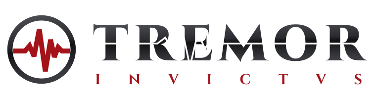

  <picture>
    <source media="(prefers-color-scheme: dark)" srcset="misc/logo/tremor-invictus-horizontal-on-dark.svg">
    
  </picture>

# tremor-invictus

A fast arena shooter with champion classes, built on the
[ioquake3](https://github.com/ioquake/ioq3) engine. Every player picks a
champion: a body class (light, medium or heavy) with its own size, speed,
health and armor, a movement style, and sometimes an active ability.

The project ships code only. It runs on your own copy of Quake III Arena's
game data (maps, models, sounds); none of that data is included here.

Runs on macOS, Windows and Linux.

## Status

Early and playable. Player models, maps and sounds currently come from your
Quake III Arena install as stand-ins. Movement numbers are first drafts and
every one of them is a cvar, so they can be retuned without code changes.

## Building

Each script builds the engine, the game libraries and the QVMs.

| Platform | Command | Needs | Output |
|---|---|---|---|
| macOS | `scripts/build-macos.sh` | Xcode command line tools, CMake | `build-macos/Release` |
| Windows (64-bit) | `scripts/build-windows.sh` | Docker (cross-compiles with mingw-w64) | `build-windows/Release` |
| Linux (x86_64) | `scripts/build-linux.sh` | Docker | `build-linux/Release` |

Extra CMake options can be passed through, for example
`scripts/build-macos.sh -DBUILD_SERVER=OFF`.

Before committing, enable the repository's guard against game data and
binaries once per clone:

    git config core.hooksPath misc/git-hooks

## Running

You need Quake III Arena installed; point the game at the folder that
contains `baseq3/pak0.pk3`. On macOS:

    scripts/run-macos.sh "/path/to/Quake 3 Arena" +map q3dm6 +addbot doom 3

The script loads this build's game code and leaves the Quake III Arena folder
untouched; configs and logs go to `build-macos/home`. On other platforms, run
the built binary with `+set fs_basepath "/path/to/Quake 3 Arena"`.

On macOS the game draws through Metal by default (`cl_renderer metal`): the
classic renderer with its OpenGL calls carried out on Metal, which is many
times faster there than Apple's OpenGL. `+set cl_renderer opengl1` or
`opengl2` switches back.

## Local test assets

Community models and other assets may be tried locally but never go into
this repository. Put them in `~/projects/quake/local` (or set
`TREMOR_LOCAL`): every `.pk3` or `.zip` there is loaded by
`scripts/run-macos.sh` and `scripts/test-run.sh`, and `local.cfg` there runs
on start. Point a champion at a local model with `g_championModels`, for
example in `local.cfg`:

    set g_championModels "deathknight=dark_knight galena=galena"

The commit guard refuses archives and model files, and `.gitignore` skips
them.

## Test runs

`scripts/test-run.sh` runs the game for automated tests without disturbing
anyone using the machine: no sound, all keyboard and mouse input ignored,
the window placed off-screen, a background app with its own bundle ID, and
its own build, home folder and port. Tests drive it over rcon on localhost
(macOS):

    scripts/test-run.sh build
    TREMOR_Q3="/path/to/Quake 3 Arena" scripts/test-run.sh start -n mytest +map q3dm1
    scripts/test-run.sh rcon -n mytest "screenshotJPEG"
    scripts/test-run.sh stop -n mytest

The engine settings behind it are `in_ignoreInput 1` and
`r_offscreenWindow 1`.

## Playing

| Action | How |
|---|---|
| Pick a champion | Esc, then **Champion**, or `/champion <name>`; it applies when you next spawn |
| Champion ability | bind a key to `+button12`, for example `bind e +button12` |
| Auto-hop | holding jump jumps again on landing; turn off with `cg_autoHop 0` |

### Player colours

Esc, then **Player Colors**, forces a skin on enemies and teammates: *bright*
(flat colour, visible in dark corners) or *sport* (the model tinted), with a
colour for head, upper and lower body. The same settings are cvars:
`cg_forceEnemySkin`, `cg_forceTeamSkin`, `cg_enemyHeadColor` and so on
(`0xRRGGBB` or `0xRRGGBBAA`), plus weapon, grenade and corpse colours.
Champion models are never replaced, so every enemy keeps its true size.

### Body classes

| Class | Half-width | Health | Armor (base / max) | Spawn armor |
|---|---|---|---|---|
| Light | 13 | 100, up to 175 | 75 / 150 | 25 (0 in duel) |
| Medium | 15 | 100, up to 175 | 100 / 175 | 50 |
| Heavy | 17 | 100, up to 175 | 125 / 200 | 75 |

Everyone spawns with 125 health, which counts down to 100. Armor above the
base value counts down too.

### Movement styles and abilities

| Style or ability | Champions | What it does |
|---|---|---|
| Standard | most | classic strafe-jumping |
| Air control | anarki, sorlag | sharp side-strafe turns and steering with forward held |
| Crouch slide | slash, strogg | falling charges a slide; crouch on landing to keep speed |
| Wall jump | nyx | jump off a wall in the air, once per airtime |
| Double jump | doomslayer | jump again in the air, once per airtime |
| Air-dodge and acceleration | clutch | double-tap a direction in the air to dash; running straight builds speed |
| Heavyweight and bull rush | scalebearer | running into enemies hurts them; the ability charges forward |
| Hook and ramp jump | athena | the ability throws a hook (hold to swing); jumping off a climb goes higher |

Champion data lives in one table in `code/game/bg_misc.c`. Movement numbers
are `pm_*` cvars, which the server sends to clients; ability numbers are
`g_*` cvars.

## Roadmap

- Retune movement and abilities to final numbers
- Champion select screen and ability HUD polish
- More languages (all game text already goes through one string table)
- Free replacement models, maps and sounds, so the game runs without
  Quake III Arena data

## License

tremor-invictus is free software under the GNU General Public License,
version 2 or later; see [COPYING.txt](COPYING.txt).

It is based on ioquake3, which is based on the Quake III Arena source code
released by id Software. Copyright (C) 1999-2005 Id Software, Inc., and the
ioquake3 contributors; their copyright notices stay in the source files.
Quake III Arena's game data is not covered by this license and is not
included. The original ioquake3 README, with its credits, build notes and
cvar reference, is kept in [README-ioquake3.md](README-ioquake3.md).
